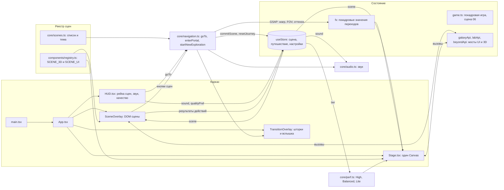
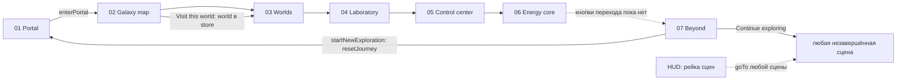

# NEBULA — аудит архитектуры

Этап 0.2.1. Ограниченный аудит: только каркас приложения и связи между сценами. Внутренняя реализация отдельных сцен не разбиралась.

- Контрольная точка Git: `bf49199d8eb4e7fc07165881110a18206fce179a` (ветка `main`).
- Метод: чтение кода. В рамках этого этапа браузерные тесты не запускались. Пометка «наблюдалось» означает результат предыдущей браузерной проверки в этой же сессии, здесь он не перепроверялся.
- Структура документа: разделы 1–7 содержат только аудит архитектуры 0.2.1. Раздел 8 добавлен позже и содержит результаты предыдущего этапа 0.2 (технические и браузерные проверки), он не относится к аудиту 0.2.1. Раздел 9 сводит всё в предварительный список задач.

## 1. Используемая архитектура

Одностраничное клиентское приложение без маршрутизации и без сервера.

| Слой | Технология |
|---|---|
| Сборка и язык | Vite 8, TypeScript (strict), React 19 |
| 3D | Three.js через React Three Fiber, `@react-three/drei` |
| Анимация | GSAP (переходы, твины 3D), Framer Motion (интерфейс) |
| Состояние | Zustand, одно хранилище |
| Звук | Собственный процедурный движок на Web Audio, без файлов |
| Стили | Чистый CSS: токены, глобальные правила, kit интерфейса, файл на сцену |
| Шрифты и иконки | Geist и Geist Mono (variable), Phosphor |

Ключевые принципы, которые заложены в коде:

1. **Одно непрерывное пространство.** Один постоянный `Canvas` на всё приложение. Туманность (`Backdrop`) и звёздное поле (`Starfield`) никогда не размонтируются. Сцена добавляет только свою 3D-группу и свой DOM-оверлей.
2. **Сцена = два компонента.** 3D-часть `*Scene.tsx` внутри общего Canvas и DOM-часть `*UI.tsx` над ним. Их связывает реестр.
3. **Покадровые данные вне React.** Всё, что меняется каждый кадр, лежит в изменяемых объектах (`fx`, `game`, `galaxyClock`) и читается в `useFrame`. Через Zustand идёт только то, что меняется по действию пользователя.
4. **Один сценарий перехода.** Все переходы идут через `goTo()` в `core/navigation.ts` и один GSAP-таймлайн.
5. **Три уровня качества.** High, Balanced, Lite задаются таблицей `TIERS` в `core/perf.ts` и читаются сценами.

## 2. Основные файлы и их назначение

| Файл | Назначение |
|---|---|
| `index.html` | Точка входа браузера, мета-теги, подключает `src/main.tsx` |
| `src/main.tsx` | Монтирует `<App />` в `StrictMode`, подключает шрифты и общие CSS |
| `src/App.tsx` | Корневой компонент: проверка WebGL, сборка каркаса, `SceneOverlay` |
| `src/core/scenes.ts` | Список семи сцен: id, номер, название, оттенок туманности, скорость дрейфа звёзд, FOV |
| `src/components/registry.ts` | Два реестра `SCENE_3D` и `SCENE_UI`: id сцены в компонент |
| `src/components/Stage.tsx` | Единый `Canvas`, `SceneHost`, граница ошибок, `PerfMonitor`, обработка потери контекста |
| `src/core/store.ts` | Единственное Zustand-хранилище, функция `explorationIndex` |
| `src/core/navigation.ts` | `goTo`, `enterPortal`, `startNewExploration`: таймлайны переходов |
| `src/core/fx.ts` | Изменяемое покадровое состояние переходов (`warp`, `fovKick`, `cruise`, оттенок туманности) и ссылки на DOM шторок |
| `src/core/audio.ts` | Синглтон `audio`: движок звука, фон по сцене, эффекты |
| `src/core/perf.ts` | Уровни качества `TIERS`, определение уровня `detectTier`, проверка WebGL |
| `src/components/HUD.tsx` | Рейка сцен, переключатель звука, меню с настройкой качества |
| `src/components/TransitionOverlay.tsx` | Шторки и вспышка, ими управляет таймлайн через `overlayRefs` |
| `src/components/ui.tsx` | Общие элементы: `Button`, `Panel`, `Meter`, `Switch`, `Range`, `WordReveal`, `SceneTitle` |
| `src/gfx/*` | Общая графика: `Backdrop`, `Starfield`, шейдерные куски, текстура свечения |
| `src/data/*` | Статические данные галактики и миров |
| `src/scenes/<имя>/` | Папка на сцену: 3D, интерфейс, CSS, локальные данные и «мосты» |
| `src/styles/*` | `tokens.css` (токены), `global.css`, `ui.css` (kit интерфейса) |

## 3. Схема взаимодействия

### 3.1. Каркас и потоки данных

### 3.2. Маршрут по сценам

Сцены не вызывают друг друга напрямую. Они связаны через три механизма:

1. **`goTo(id)`**: каждая сцена в своём интерфейсе знает только следующую сцену и вызывает переход.
2. **Хранилище**: сцена записывает результат действий, финальная сцена читает всё сразу.
3. **Прямая передача выбора**: единственный случай, где сцена задаёт состояние для другой, это «Visit this world» в галактике: `setWorld(...)` и затем `goTo('worlds')`.

## 4. Механизм хранения общего состояния

### 4.1. Хранилища Zustand

Одно: `useStore` в `core/store.ts`. Срезов нет, все поля лежат в одном объекте. Других хранилищ в проекте нет.

| Группа | Поля |
|---|---|
| Навигация | `scene`, `pending`, `transitioning`, `entered`, `portalOpening`, `visited`, `ready` |
| Галактика | `galaxySelected`, `scanned` |
| Миры | `world`, `worldsVisited` |
| Лаборатория | `labMode`, `labModes`, `labNodes`, `labScale`, `labSpin` |
| Корабль | `power`, `sw`, `reactorTemp`, `log`, `identified`, `pings`, `touched` |
| Энергетическое ядро | `coreResult`, `coreAttempts`, `coreBest` |
| Настройки | `sound`, `qualityPref`, `tier`, `tierReason`, `toast` |
| Служебное | `startedAt` |

Общие данные путешествия это группы «Галактика», «Миры», «Лаборатория», «Корабль» и «Ядро». Финальная сцена читает их через `scenes/beyond/results.ts` (`compute`, `useResults`) и общий индекс `explorationIndex()` из хранилища. Статические данные лежат в `data/*` и в локальных файлах сцен.

### 4.2. Состояние вне хранилища (изменяемые модульные объекты)

| Объект | Файл | Что хранит | Кто читает |
|---|---|---|---|
| `fx` | `core/fx.ts` | `warp`, `cruise`, `fovKick`, `baseFov`, `dolly`, `portalOpen`, оттенок туманности | `Backdrop`, `Starfield`, `Stage`, сцены |
| `overlayRefs` | `core/fx.ts` | DOM шторок и вспышки | `navigation.ts` |
| `game` | `scenes/core/game.ts` | Покадровое состояние игры ядра | Планируется для сцены 06 |
| `galaxyApi`, `galaxyClock` | `scenes/galaxy/galaxyApi.ts` | Функции зума и сброса, время сцены | Интерфейс и 3D галактики |
| `labApi` | `scenes/laboratory/labApi.ts` | `resetView`, `pulse`, флаг `sheetOpen`, общие uniforms | Интерфейс и 3D лаборатории |
| `beyondApi` | `scenes/beyond/beyondApi.ts` | `surge` | Интерфейс и 3D финала |
| `audio` | `core/audio.ts` | Движок звука | HUD, кнопки, переходы |

### 4.3. Персистентность

Только два значения в `localStorage` (через `safeStorage`, который ловит блокировку хранилища): `nebula.sound` и `nebula.quality`. Прогресс путешествия хранится только в памяти и сбрасывается при перезагрузке страницы.

### 4.4. Ключевые механизмы

**Точка входа.** `index.html` → `src/main.tsx` → `App`. `App` проверяет `hasWebGL()`. Без WebGL показывается `NoWebGL`. Иначе собираются `Stage`, `SceneOverlay`, `HUD`, `Toast`, `TransitionOverlay`, `Boot`.

**Переключение сцен.** Роутера нет. Активная сцена это `store.scene`. `SceneHost` (в `Stage.tsx`) отрисовывает `SCENE_3D[scene]`, `SceneOverlay` (в `App.tsx`) отрисовывает `SCENE_UI[scene]`. Оба компонента с `key={scene}`, поэтому старая сцена размонтируется, новая монтируется.

**Переходы.** `goTo(target)` блокируется при `transitioning` или той же сцене. Порядок: `beginTransition` (`pending`, `transitioning`) → таймлайн GSAP: шторки, `warp`, толчок FOV, вспышка → в середине `commit()` (`commitScene`, сброс `fx`, новый оттенок туманности, `audio.setScene`) → обратное затухание → `endTransition`. Старый оверлей гаснет на время перехода (`is-leaving`, `pointer-events: none`). Особые случаи: предварительное открытие портала, укороченный вариант при `prefers-reduced-motion`, отдельный таймлайн `startNewExploration` с `resetJourney` в момент затемнения.

**Звук.**
- Состояние: `store.sound`, по умолчанию включён, сохраняется в `nebula.sound`.
- Движок: `audio` из `core/audio.ts`. `AudioContext` создаётся только после жеста пользователя: `audio.start()` вызывается из `enterPortal` и переключателя звука в HUD. `setEnabled` управляет мастер-громкостью, `setScene` меняет основной тон фона, `play(sfx)` ничего не делает, пока контекст не запущен.
- Интерфейс: кнопка звука в HUD и переключатель в меню.

**Lite Mode.**
- Состояние: `store.qualityPref` (`auto`, `high`, `balanced`, `lite`, сохраняется в `nebula.quality`), `store.tier`, `store.tierReason`.
- Параметры: таблица `TIERS` в `core/perf.ts` (пиксельное отношение, число звёзд, частиц, детализация, размер запечённой туманности, антиалиасинг).
- Выбор: `detectTier()` при создании хранилища (ядра, память, тач, размер экрана, `reduced motion`, программный рендер) и `PerfMonitor` в `Stage.tsx`, который понижает уровень, если частота кадров ниже 30 несколько секунд подряд и качество выбрано автоматически.
- Интерфейс: переключатель качества в меню HUD.

## 5. Обнаруженные архитектурные проблемы

Серьёзность дана по влиянию на дальнейшую разработку, без преувеличения.

### Существенные

**A1. Идентичность `Canvas` зависит от антиалиасинга.** В `Stage.tsx` ключ `Canvas` включает `cfg.aa`. Смена качества на уровень с другим `aa` (например, Balanced → Lite, в том числе автоматическое понижение `PerfMonitor`) и восстановление после потери контекста перемонтируют весь Canvas. Наблюдалось ранее в этой сессии: ошибки React при перемонтировании, в production-сборке `NotFoundError: removeChild`. Приложение продолжало рисовать, но именно путь автоматического перехода на Lite и ручной смены качества затронут. Не перепроверялось на этом этапе.

**A2. Сцена 06 не подключена к архитектуре.** `scenes/core/game.ts` готов, но его не импортирует ни один файл, а `CoreScene` и `CoreUI` остаются заглушками. Кроме того, `resetJourney` не знает про модульное состояние `game`: после «Start new exploration» игра сохранит старое состояние, если не сбрасывать её при размонтировании сцены.

**A3. Нет границы ошибок вокруг DOM-интерфейса.** `StageBoundary` защищает только `Canvas`. Исключение в `*UI.tsx` любой сцены, в `HUD` или в `Toast` обрушит всё React-дерево. Это особенно важно, пока четыре интерфейса сцен написаны недавно и ещё мало проверены.

### Средние

**A4. Итоги путешествия задублированы.** Количество объектов галактики (8) жёстко зашито в `explorationIndex` в `store.ts`, а `results.ts` берёт `GALAXY_OBJECTS.length`. Число органов управления корабля (10) записано и в `store.ts`, и в `results.ts` (`SHIP_CONTROLS`). Числа 3 (миры) и 4 (режимы, узлы) тоже повторяются. Есть две точки правды для одного понятия «прогресс».

**A5. `touched` слабо типизирован.** Поле `touched: string[]` хранит строки по неформальному протоколу (`power:<ключ>`, `switch:<ключ>`, `radar:ping`, `radar:identify`). Корректность `SHIP_CONTROLS = 10` держится на том, что таких ключей ровно десять. Добавление элемента управления молча сломает расчёт.

**A6. Обход действий хранилища и хрупкий порядок.** `ControlUI` вызывает `setPower`, а затем напрямую `useStore.setState` для остальных систем. `startNewExploration` после `resetJourney` вручную восстанавливает `transitioning` и `pending` через `setState`, потому что сброс их очищает. Логика коммита сцены дублируется в `commit()` (для `goTo`) и `done()` (для `startNewExploration`).

**A7. «Мосты» между интерфейсом и 3D не имеют единого контракта.** `galaxyApi`, `labApi`, `beyondApi` это изменяемые глобальные объекты с пустыми функциями по умолчанию, которые сцена подменяет при монтировании. Работает, но нет общего паттерна регистрации и очистки, а `labApi.sheetOpen` и `galaxyClock` это нереактивные флаги. Вызов до монтирования сцены молча ничего не делает.

### Незначительные и потенциальные

**A8.** Мёртвое состояние: поле `visited` обновляется в `commitScene`, но нигде не читается. `startedAt` нужен только для меток времени в журнале корабля.

**A9.** Все семь сцен подключены статическим импортом в `registry.ts`, код-сплиттинга нет. Один JS-бандл около 1,6 МБ (около 459 кБ gzip), а `chunkSizeWarningLimit: 2000` в `vite.config.ts` скрывает предупреждение сборки.

**A10.** CSS подключается непоследовательно: стили порталa и галактики импортируются в `main.tsx`, стили остальных сцен в их `*UI.tsx`.

**A11.** `useResults()` подписывается на всё хранилище без селектора. Сейчас это безвредно, но вызовет лишние перерисовки, если финальная сцена начнёт получать частые обновления.

**A12.** `detectTier()` вызывается при импорте `store.ts` и создаёт временный WebGL-контекст, плюс ещё один создаёт `hasWebGL()` в `App`. Побочный эффект при импорте модуля, мелкий, но мешает тестированию.

**A13.** Нет ESLint, тестов и форматтера. В коде есть три комментария `eslint-disable react-hooks/exhaustive-deps` для правила, которое не настроено.

## 6. Рекомендации для дальнейшей разработки

Порядок по зависимостям, не по важности.

1. **Развязать идентичность `Canvas` и качество (A1).** Не включать `aa` в `key`, применять изменения уровня без перемонтирования, для восстановления контекста сделать отдельный явный путь. Сделать до сцены 06, чтобы автоматический переход на Lite был надёжным.
2. **Зафиксировать контракт подключения сцены 06 (A2).** `CoreScene` вызывает `step(dt)` ровно из одного `useFrame`, `CoreUI` подписывается через `subscribe`, при размонтировании вызывается `resetToIntro`, а сброс путешествия сбрасывает и `game`. Кнопка «Continue» ведёт `goTo('beyond')`.
3. **Свести итоги путешествия к одному модулю (A4, A5).** Один файл с итогами, выведенными из данных (`GALAXY_OBJECTS.length`, список ключей управления), типизированные ключи `touched`, `explorationIndex` и `results.ts` берут числа оттуда.
4. **Выделить общий проигрыватель переходов (A6).** `goTo` и `startNewExploration` используют одну функцию с параметром «что сделать в момент затемнения», убрать ручной `setState` после сброса.
5. **Добавить границу ошибок на уровне `App` (A3)** для оверлея и HUD с кнопкой перезагрузки.
6. **Унифицировать мосты сцен (A7).** Одна функция регистрации и очистки вместо произвольных объектов, либо перевод на события в хранилище.
7. **Гигиена (A8, A10, A12, A13).** Удалить `visited` или начать использовать, определить правило подключения CSS, добавить конфигурацию ESLint, вынести `detectTier` из побочных эффектов импорта.
8. **Код-сплиттинг сцен (A9)** через `React.lazy` в реестре. После стабилизации, с проверкой, что отложенная компиляция шейдеров не даёт заметной паузы при переходе.

## 7. Открытые вопросы

1. Нужно ли сохранять прогресс путешествия между перезагрузками страницы? Сейчас нет, в брифе это не требуется. Решение за заказчиком.
2. Должен ли сброс путешествия очищать модульные синглтоны (`game`, `labApi.sheetOpen`)? Ответ определится при реализации сцены 06.
3. Намеренно ли автоматическое выключение переключателей при аварийном отключении реактора засчитывается в `touched`? Код `cutoff` в `ControlUI` вызывает `toggleSwitch`, что добавляет записи. Относится к внутренней логике сцены 05.
4. Пороги `PerfMonitor` (30 кадров в секунду, четыре секунды подряд) и эвристики `detectTier` не откалиброваны на реальных устройствах. Измерений на настоящем GPU в проекте нет.
5. Как звук и состояние ведут себя при возвращении во вкладку после `visibilitychange`: код приостанавливает и возобновляет контекст, но на реальном устройстве это не проверялось.

---

## 8. Результаты предыдущего тестирования и дополнительные наблюдения

> **Происхождение раздела.** Это результаты этапа 0.2 («Технический аудит существующего проекта», 2 ноября 2026), проведённого до аудита архитектуры 0.2.1 и по другому заданию. Они **не входят** в аудит 0.2.1 (разделы 1–7), получены другим методом (запуск проверок и браузерный прогон) и в рамках 0.2.1 не перепроверялись. Контрольная точка Git на момент проверок та же: `bf49199`, рабочее дерево было чистым.

### 8.1. Окружение и методика

- Проверки выполнялись в облачном контейнере. Dev-сервер Vite работал на `127.0.0.1:5180`, production-превью на `127.0.0.1:5181`. После проверок серверы остановлены.
- Браузер: Chromium через Playwright, режим headless. WebGL работал через программный рендерер ANGLE SwiftShader. Приложение само определило это как «software renderer» и выбрало уровень Lite.
- Размеры окна: десктоп 1440×900, планшет 820×1180, телефон 390×844 (с эмуляцией мобильного режима и касаний).
- Тестовые скрипты и скриншоты лежат в рабочей папке сессии вне репозитория. В репозитории не изменено ничего. Единственные побочные эффекты: пересобрана папка `dist/` и создан кэш `node_modules/.vite`, оба пути в `.gitignore`.
- Автоматические проверки сценариев подтверждали результат по тексту и состоянию интерфейса, часть скриншотов просмотрена глазами.

### 8.2. Технические проверки

| Проверка | Результат |
|---|---|
| TypeScript (`tsc --noEmit`) | Пройдена, код выхода 0, ошибок нет |
| ESLint | Не запускался: конфигурации нет, ESLint в `package.json` не указан и в `node_modules/.bin` отсутствует |
| Production build (`npm run build`) | Пройдена за 3,0 с, 5595 модулей. `index.html` 1,29 кБ. JS 1 597,25 кБ (gzip 459,19 кБ), CSS 38,72 кБ (gzip 7,59 кБ), шрифты woff2 |
| Запуск dev-сервера | Успешно, ответ HTTP 200 |
| Тесты | В проекте отсутствуют (файлов `*.test.*` и `*.spec.*` нет) |

### 8.3. Браузерная проверка на десктопе (1440×900)

Ниже зафиксировано то, что отработало в браузере. Часть шагов в сценариях была «по возможности» (best effort), это указано явно.

| Сцена | Что проверено и результат |
|---|---|
| Загрузка | Экран загрузки исчезает, рейка сцен до входа скрыта, кнопка бренда отключена |
| 01 Portal | «Enter the unknown» открывает портал и переводит в галактику |
| 02 Galaxy map | Кнопки зума, перетаскивание, колесо и сброс вида работают без ошибок. Выбор из списка из 8 объектов открывает карточку. Сканирование отработало (счётчик «3 of 8 scanned»). «Visit this world» ведёт в Worlds. Выбор кликом по самому 3D-объекту работает (клик рядом с подписью «Verglas» открыл карточку «Verglas») |
| 03 Worlds | Три мира переключаются: Frozen World, Fire World, Bioluminescent World. Счётчик показал «3 of 3 visited». Стрелки клавиатуры переключают миры, перетаскивание планеты не вызывает ошибок, «Enter laboratory» ведёт дальше |
| 04 Laboratory | Четыре режима переключаются, текст пояснения меняется. Ползунок масштаба изменил значение с 1.00x на 1.40x. Переключатель авто-вращения работает. Четыре узла дали «4 of 4 active», появилось сообщение о резонансе, показатель Output вырос с 2,5 TW до 15,0 TW. «Send a pulse» и «Reset the view» без ошибок. Клик по узлу в 3D переключил узел (best effort: точка найдена перебором наведения). Переход «Enter control center» работает |
| 05 Control center | Ползунки мощности соблюдают общий бюджет (значения 50, 68, 100, 20, сумма 238 из 240). Четыре переключателя работают, журнал вырос с 4 до 8 записей. Пинг, список контактов (9 при включённом глубоком сканировании) и «Identify» работают. Клик по радару выбрал контакт «Drifting debris» (best effort). Реактор дошёл до предупреждения и затем до автоматического аварийного отключения: питание сброшено на 50 по всем системам, три «горячих» переключателя выключены, максимум температуры 97. Ручная кнопка «Emergency cutoff» сбросила двигатели на 50. «Stabilize the core» ведёт в сцену 06 |
| 06 Energy core | **Заглушка.** В интерфейсе 0 интерактивных элементов, виден только фон туманности и HUD |
| 07 Beyond | Открылась через рейку сцен. Статистика отражала действия теста: индекс 60, объекты 3 из 8, миры 3 из 3, режимы лаборатории 4 из 4, узлы 1 из 4, органы управления 10 из 10, опознано контактов 1, ядро «Not attempted». «Pulse the gateway» без ошибок. Список незавершённого содержал 3 строки, «Continue exploring» перевёл в сцену 06. «Start new exploration» вернул в портал, рейка сцен скрылась. После сброса вход в галактику снова работает, прогресс «0 of 8 scanned» |
| Звук | Переключатель в HUD меняет подпись «Turn sound off» и «Turn sound on» и записывает `nebula.sound` в `localStorage` |
| Качество | В меню можно выбрать High, Balanced, Lite, Auto. Подпись показывала «Now running Lite. Chosen for this device: software renderer», а после ручного выбора «Set by you» |
| Клавиатура | Первое нажатие Tab фокусирует ссылку «Skip to content» |

**Частота кадров** измерялась на программном рендерере на уровне Lite: портал 9, галактика 10,3, миры 9, лаборатория 8,3, пульт 6 кадров в секунду. Эти числа **не отражают** работу на реальном GPU и не годятся для оценки производительности.

### 8.4. Игровая логика сцены 06 (симуляция)

Интерфейса сцены нет, поэтому логика `game.ts` проверена программно в браузере: модуль подгружен динамическим импортом через dev-сервер и прогнан шагами по 1/30 с.

| Сценарий | Результат |
|---|---|
| «Идеальный игрок» (клапаны всегда в центре окна) | Победа на 20,0 с, целостность 100 |
| Бездействие | Поражение на 9,9 с: нестабильность достигла предела |
| «Медленный человек» (поправка раз в ~0,5 с) | Победа на 20,7 с, целостность 97 |

Дополнительно: счётчик попыток в хранилище вырос до 3, лучший результат записан в `coreBest`, констант `TIME_LIMIT = 55` и `FLOW_COUNT = 3`. Поражение по времени (55 с) не проверялось. Баланс на реальном вводе человека не оценивался. Файл `game.ts` не импортируется ни одним модулем приложения, поэтому dev-хук `window.__core` существует, только если модуль загрузить вручную.

### 8.5. Адаптивность (планшет 820×1180 и телефон 390×844)

- Горизонтального переполнения страницы нет ни в одной из семи сцен: ширина содержимого равна ширине окна.
- Главная кнопка портала помещается на первый экран.
- Карточка объекта в галактике после выбора, а также нижняя панель управления лаборатории на мобильном, не выходят за экран.
- Прокручиваемые области пульта и финала прокручиваются колесом мыши: планшет, пульт 0 → 600 из 970, финал 0 → 551 из 551. Телефон, пульт 0 → 600 из 1932, финал 0 → 600 из 918. Это эмуляция колеса, **реальная прокрутка касанием не проверялась**.
- Элементы за пределами экрана: на телефоне в финале строки раздела «Still open» занимают горизонтальный диапазон 33–419 пикселей при ширине экрана 390. Остальные элементы на планшете и телефоне в экран помещаются.
- Сообщения «clipped text: Scene 0X» в автоматическом отчёте оказались ложными срабатываниями: это скрытая живая область для скринридера.
- Ошибок консоли в проходах по планшету и телефону не было.
- Малые цели нажатия: кнопка бренда в HUD 127×28 пикселей, кнопка «Ping» 80×30. Для требований WCAG 2.2 уровня AA (24 пикселя) это допустимо, для рекомендуемых 44 пикселей мало.

### 8.6. Ошибки консоли, смена качества и потеря контекста

**Что наблюдалось.** В первом десктопном прогоне в консоли были 8 ошибок «Attempted to synchronously unmount a root while React was already rendering», а также предупреждения `THREE.Clock: This module has been deprecated` (предупреждение библиотеки) и «GPU stall due to ReadPixels» (драйверное, в `src` нет вызовов `readPixels`, вероятно, артефакт headless-режима, не подтверждено).

**Привязка к действиям.** Отдельный прогон с метками показал: при обычном проходе по всем сценам консольных ошибок нет ни в dev, ни в production. Ошибки вызывают:

| Действие | Dev | Production |
|---|---|---|
| Смена качества на High | 8 ошибок «synchronously unmount» | Страница не падает сразу, но ошибка `NotFoundError: Failed to execute 'removeChild' on 'Node'` (`pageerror`) возникла при следующем переходе в Worlds |
| Смена качества на Lite | 8 ошибок и 1 `pageerror` | Не проверялось отдельно |
| Восстановление контекста WebGL | 8 ошибок | Не проверялось отдельно |

Сообщения «synchronously unmount» наблюдались только в dev, `NotFoundError` воспроизведён и в production-сборке. После этих ошибок приложение продолжало рисовать (проверено по скриншотам сцен Worlds и Beyond).

**Потеря контекста WebGL.** Тост «Graphics context lost. Restoring the view.» показывается. Контекст при этом восстанавливается: канвас остаётся один, `isContextLost()` возвращает `false`, переход в другую сцену после этого работает. Но тост «Graphics restored.» **ни разу не появился** за окна наблюдения 8–12 секунд (три прогона). В зондирующем прогоне слушатель на исходном канвасе зафиксировал только `webglcontextlost`, что согласуется с гипотезой о перемонтировании канваса, но это гипотеза.

### 8.7. Обнаруженные дефекты и наблюдения

Серьёзность предварительная. «Подтверждено» означает воспроизведение в браузере, «по коду» означает вывод из чтения исходников.

| № | Наблюдение | Подтверждение | Предв. серьёзность |
|---|---|---|---|
| D1 | **Сцена 06 пуста.** `CoreScene` возвращает `null`, `CoreUI` это пустая секция. Из пульта кнопка «Stabilize the core» ведёт на экран без элементов и без кнопки дальше, выйти можно только через HUD. Достижение «Stabilizer» недостижимо, итоговый индекс не превысит 80 | Подтверждено | Критическая |
| D2 | **Подсказки с градиентным текстом не переносятся и обрезаются.** `WordReveal` (`components/ui.tsx`, строка 213) соединяет слова неразрывным пробелом: в DOM `You&nbsp;`. Подсказка финала на десктопе: рамка 420×40, ширина текста 1835 пикселей, видно «You crossed the unknow». Подсказка портала при 1440 пикселей: рамка 680, текст 1027 пикселей, обрезана. Заливка `grad-text` рисуется только внутри рамки элемента, поэтому остальной текст невидим. Нарушается требование скилла B11 (минимум две читаемые строки) | Подтверждено на десктопе. На телефоне подсказка портала не измерялась (интерфейс портала уже был размонтирован к моменту замера) | Высокая |
| D3 | **Панели финала на телефоне шире экрана.** Строки «Still open» занимают 33–419 пикселей при ширине 390, карточки достижений обрезаны («Worldwalker Visit 2 more world…»), заголовок обрезан («You crossed the unki»). Вероятная причина та же, что у D2 (неразрывная строка расширяет колонку), **не проверено** | Подтверждено визуально. Причина: гипотеза | Высокая |
| D4 | **Смена качества и восстановление контекста перемонтируют Canvas** с ошибками React и `NotFoundError` в production (см. 8.6). Затрагивает ручную смену качества и автоматический переход на Lite. Совпадает с архитектурной проблемой A1 | Подтверждено | Существенная |
| D5 | Тост «Graphics restored.» не показывается после восстановления контекста (см. 8.6) | Подтверждено, причина гипотеза | Средняя |
| D6 | Подпись объекта на карте галактики («Halcyon Gate») налезает на текст-подсказку в левом верхнем углу при определённом положении карты (скриншот 1440×900) | Подтверждено визуально, зависит от поворота | Низкая |
| D7 | На пульте при 1440×900 надпись «SHIP SYSTEMS» частично перекрыта панелью «Power», а 3D-голограмма корабля почти полностью скрыта за панелями | Визуальное наблюдение, часть про голограмму это оценка дизайна | Низкая |
| D8 | Мета-тег `og:image` указывает на `/og.png`, но в `public/` только `favicon.svg`. Превью-сервер на этот адрес отвечает кодом 200 и отдаёт `index.html`. Тега `og:url` нет | Подтверждено | Низкая |
| D9 | Малые цели нажатия: кнопка бренда 127×28, «Ping» 80×30 (см. 8.5) | Подтверждено | Низкая |
| D10 | Предупреждение `THREE.Clock` устарел (библиотека). Версии `@types/three` (`^0.186`) и `three` (`^0.187`) не совпадают | По выводу консоли и `package.json` | Низкая |
| D11 | Сборка даёт один JS-файл около 1,6 МБ, предупреждение скрыто настройкой `chunkSizeWarningLimit: 2000` | Подтверждено сборкой | Низкая |

**Наблюдения только по коду** (в браузере не воспроизводились):

- В `results.ts` оценка целостности ядра устроена эвристикой «если значение не больше 1, умножить на 100», а `game.ts` отдаёт значение от 0 до 100. Целостность 1 процент покажется как 100.
- `ControlUI.cutoff` выключает переключатели через `toggleSwitch`, что добавляет записи в `touched`. Автоматический сброс может засчитываться как «использованный орган управления». Намеренность не выяснена.
- В `GalaxyUI` таймер сканирования (`setTimeout`) не очищается при выходе из сцены.
- Симуляция реактора в `ControlUI` работает, только пока интерфейс смонтирован: температура не остывает вне сцены. Покадровый шаг ограничен 0,1 с, поэтому при низкой частоте кадров симулированное время идёт медленнее реального.
- Три комментария `eslint-disable react-hooks/exhaustive-deps` относятся к правилу, которое не настроено.

### 8.8. Ограничения проведённых проверок

1. Все замеры сделаны на программном рендерере SwiftShader, без реального GPU. Частота кадров 6–10 в секунду и автоматический выбор Lite это свойства тестовой среды. Реальная производительность и калибровка Lite не оценены.
2. Реальные мобильные устройства и настоящие касания не использовались, только эмуляция в Chromium. Прокрутка проверена колесом, а не пальцем.
3. Только Chromium. Firefox и Safari не проверялись.
4. Звук проверен только на уровне интерфейса (переключатель, `localStorage`). Вывода звука в тестовой среде нет, воспроизведение не подтверждено.
5. Не вызывались экран «NEBULA needs WebGL» и экран «Signal lost» (граница ошибок Canvas). Режим `prefers-reduced-motion` в браузере не проверялся. Клавиатурная навигация проверена частично (Tab до ссылки пропуска, стрелки в Worlds).
6. Некоторые проверки выполнены «по возможности» (клик по узлу лаборатории и по контакту радара найден подбором координат), поэтому отсутствие срабатывания в других точках не доказано.
7. Часть показателей Beyond (индекс 60, «10 of 10») получена из действий самого теста, в том числе автоматического аварийного отключения. Это не отражает типичный путь пользователя.
8. Время до автоматического аварийного отключения реактора не фиксировалось, зафиксирован только факт его срабатывания в пределах ожидания 120 секунд.
9. Сцены 04, 05 и 07 были написаны в предыдущих сессиях и до этого аудита в браузере не проверялись. Перечисленные результаты это первая проверка, а не регрессия.
10. Результаты сцен 01–03 в большей части подтверждены прохождением основных сценариев, а не исчерпывающим тестированием всех состояний.

---

## 9. Предварительный список задач

Приоритеты предварительные, их стоит подтвердить перед началом работ. Шкала: **P0** блокирует продукт или целостность прохождения, **P1** высокий (заметный дефект или риск для ключевых требований), **P2** средний, **P3** низкий (гигиена и доработки). Ссылки: «A» это проблемы архитектуры из раздела 5, «D» это дефекты из раздела 8.7.

| № | Приоритет | Задача | Источник | Примечание |
|---|---|---|---|---|
| T1 | P0 | Реализовать сцену 06 «Energy core»: 3D-ядро, управление тремя потоками, старт, обратный отсчёт, победа, проигрыш, пауза, управление с клавиатуры и касанием, переход в Beyond | D1, A2 | Логика готова и проверена симуляцией, нужны сцена и интерфейс. Контракт подключения: один `step(dt)` в `useFrame`, подписка на `subscribe`, `resetToIntro` при размонтировании, сброс игры в `resetJourney` |
| T2 | P1 | Исправить неразрывные пробелы в `WordReveal` и проверить подсказки портала и финала на трёх размерах экрана | D2 | Предположительно правка в одном символе. Выполнять с последующей проверкой |
| T3 | P1 | Проверить и при необходимости исправить выход панелей финала за экран на телефоне | D3 | Сначала повторить после T2: вероятно, исчезнет само |
| T4 | P1 | Убрать зависимость `key` Canvas от `aa` и сделать смену качества без перемонтирования. Отдельно продумать путь восстановления контекста | D4, A1 | Затрагивает автоматическое понижение до Lite и ручной выбор качества. Выполнить до или вместе с T1 |
| T5 | P1 | Повторно прогнать браузерные проверки после T1–T4 и добавить недостающие: реальное устройство и касания, Firefox и Safari, экран без WebGL, экран «Signal lost», `prefers-reduced-motion`, звук на слух | Разд. 8.8 | Закрывает ограничения 2–5 |
| T6 | P2 | Показать тост «Graphics restored.» после восстановления контекста, подтвердить причину | D5 | Связано с T4 |
| T7 | P2 | Добавить границу ошибок на уровне приложения для HUD, оверлея и тостов с кнопкой перезагрузки | A3 | Особенно важно при пяти новых интерфейсах сцен |
| T8 | P2 | Свести итоги путешествия к одному модулю (число объектов, миров, режимов, узлов, органов управления) и типизировать ключи `touched` | A4, A5 | Расчёт `explorationIndex` и `results.ts` должен брать числа из одного места |
| T9 | P2 | Выделить общий проигрыватель переходов для `goTo` и `startNewExploration`, убрать ручной `setState` после сброса | A6 | |
| T10 | P2 | Измерить производительность на реальном GPU и откалибровать пороги `PerfMonitor` и эвристики `detectTier` | Разд. 7 (вопрос 4), 8.8 | Требует реальных устройств |
| T11 | P2 | Решить, засчитывается ли автоматическое аварийное отключение как «использованные органы управления», и исправить расчёт целостности ядра в `results.ts` | Разд. 8.7 (по коду) | Нужно решение по логике |
| T12 | P3 | Подпись объекта в галактике налезает на подсказку, перекрытие заголовка и голограммы на пульте | D6, D7 | Визуальная доработка, голограмму оценить как решение дизайна |
| T13 | P3 | Добавить `og:image` (файл `og.png` в `public/`) и `og:url` | D8 | |
| T14 | P3 | Увеличить цели нажатия в HUD и у кнопки «Ping» | D9 | |
| T15 | P3 | Единый контракт регистрации мостов `galaxyApi`, `labApi`, `beyondApi` | A7 | |
| T16 | P3 | Гигиена: убрать неиспользуемое `visited`, выбрать правило подключения CSS, вынести `detectTier` из побочных эффектов импорта, очистить таймер сканирования в `GalaxyUI` | A8, A10, A12, разд. 8.7 | |
| T17 | P3 | Настроить ESLint (и при желании форматтер и базовые тесты), согласовать версии `three` и `@types/three` | A13, D10 | |
| T18 | P3 | Разбить сцены на чанки через `React.lazy` и убрать скрытие предупреждения о размере | A9, D11 | После стабилизации, с проверкой пауз при компиляции шейдеров |
| T19 | Решение | Решить, нужно ли сохранять прогресс между перезагрузками страницы | Разд. 7 (вопрос 1) | Продуктовое решение, не задача разработки до ответа |

**Предлагаемый порядок.** T2 и T3 (быстрые, снимают видимый дефект финала и портала) → T4 (надёжность Lite) → T1 (основная недостающая сцена) → T5 (повторная проверка) → T7–T9, T11 → T10 на реальных устройствах → задачи P3 по ходу.
